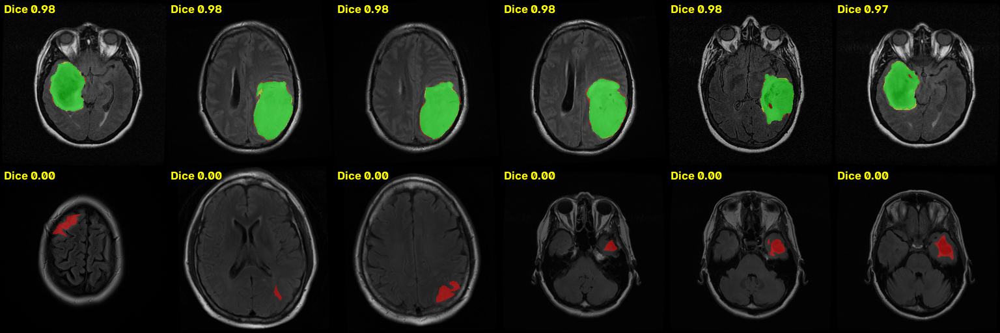
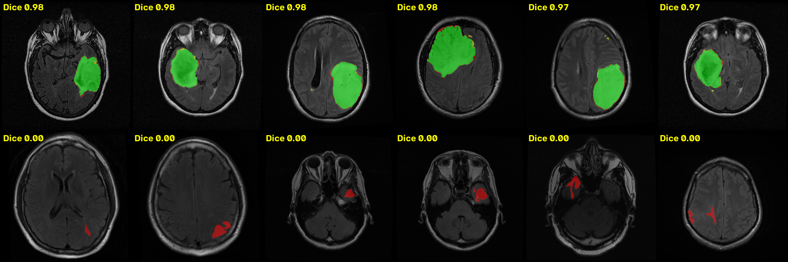

# LGG MRI Segmentation – 1-Channel U-Net

Segmentation of lower-grade gliomas on brain MRI (FLAIR) with a U-Net (ResNet34 encoder) that uses a single input channel. The model takes an MRI slice and outputs a binary mask of the tumour pixels. The project compares a baseline with two add-ons that can be combined: augmentation and lesion oversampling. All results are reported on a **test split that was never used for training or tuning**.

**W&B project:** https://forge.coreweave.com/wandb/segmentation-zneus/lgg-mri-segmentation <!-- check that the project is set to Public and opens in a private browser window -->

## Dataset

| | |
|---|---|
| Name | LGG MRI segmentation |
| Size | 3,929 slices from 110 patients (TCGA) |
| Content | brain MRI (FLAIR), lower-grade glioma, with manual tumour masks |
| Resolution | 256×256, 3 channels (pre-contrast, FLAIR, post-contrast) |
| File size | about 700 MB |
| License | CC BY-NC-SA 4.0 |
| Source | https://www.kaggle.com/datasets/mateuszbuda/lgg-mri-segmentation |

The dataset is not included in the repository and has to be downloaded. Expected layout (one folder per patient):

```
lgg-mri-segmentation/
└── kaggle_3m/
    ├── TCGA_CS_4941_19960909/
    │   ├── TCGA_CS_4941_19960909_1.tif
    │   ├── TCGA_CS_4941_19960909_1_mask.tif
    │   └── ...
    └── ...
```

The Kaggle download often contains the folder twice, nested inside itself. The script handles this and removes duplicates by file name.

## Installation

```bash
pip install segmentation-models-pytorch opencv-python wandb torch
wandb login
```

## Usage

```bash
# 0) log in to W&B once (use the --host line if the team lives on wandb.ai)
python -m wandb login --relogin --host https://api.wandb.ai

# 1) baseline: 1 channel, nothing else
python U-net.py --root ./lgg-mri-segmentation --wandb-host https://api.wandb.ai --wandb-group final --run-name baseline

# 2) baseline + augmentation
python U-net.py --root ./lgg-mri-segmentation --wandb-host https://api.wandb.ai --wandb-group final --augment --run-name aug

# 3) baseline + lesion oversampling
python U-net.py --root ./lgg-mri-segmentation --wandb-host https://api.wandb.ai --wandb-group final --lesion-oversampling --run-name oversample

# 4) both together (do not use '+' in the run name)
python U-net.py --root ./lgg-mri-segmentation --wandb-host https://api.wandb.ai --wandb-group final --augment --lesion-oversampling --run-name aug-oversample
```

The defaults are 20 epochs, W&B team `segmentation-zneus` and project `lgg-mri-segmentation`. If the team lives on a different W&B server (e.g. the CoreWeave one), drop `--wandb-host` and the `--host` argument of the login. Add `--no-wandb` for a quick local test without logging.

### Options

| Option | Default | Description |
|---|---|---|
| `--root` | (required) | dataset folder |
| `--channel` | `1` | input channel: 0 = pre-contrast, **1 = FLAIR**, 2 = post-contrast |
| `--augment` | off | enable augmentation (see below) |
| `--lesion-oversampling` | off | lesion crop and 50/50 tumour / tumour-free sampling in the train set |
| `--crop-size` | `128` | crop size used with oversampling |
| `--val-frac` | `0.15` | fraction of patients used for validation |
| `--test-frac` | `0.15` | fraction of patients used for testing |
| `--epochs` | `20` | number of epochs |
| `--bs` | `16` | batch size |
| `--lr` | `1e-3` | learning rate (AdamW) |
| `--weights` | `imagenet` | encoder weights: `imagenet` or `none` |
| `--workers` | `2` | number of DataLoader workers |
| `--run-name` | automatic | run name (also determines the output file names) |
| `--wandb-project` | `lgg-mri-segmentation` | W&B project (created automatically by the first run) |
| `--wandb-entity` | `segmentation-zneus` | W&B team / username |
| `--wandb-group` | – | group runs together |
| `--wandb-host` | – | W&B server to log to, e.g. `https://api.wandb.ai` (default: the one you are logged in to) |
| `--wandb-mode` | `online` | `offline` logs locally; upload later with `python -m wandb sync` |
| `--no-wandb` | off | disable W&B logging |

### Sharing the W&B results publicly

A W&B team can forbid public projects (Team settings → Privacy → "public sharing not allowed"), and no script can override that. To obtain a public link:

```bash
# A) log to a public-capable account on wandb.ai, then set the project to Public (Settings -> Privacy)
python U-net.py --root ./lgg-mri-segmentation --wandb-host https://api.wandb.ai --wandb-entity <your-username> --run-name baseline

# B) log offline now, upload later from any account
python U-net.py --root ./lgg-mri-segmentation --wandb-mode offline --run-name baseline
python -m wandb sync --entity <your-username> --project lgg-mri-segmentation wandb/offline-run-*
```

Independently of W&B, every run also saves `results_<run>/history.csv` (per-epoch curves) and `results_<run>/metrics.json` (config, split sizes, val/test metrics, failure counts), so the numbers can be shared without W&B.

## Method

**Model.** `smp.Unet("resnet34", in_channels=1, classes=1)`. The pretrained ImageNet weights are adapted to 1 channel automatically by `segmentation-models-pytorch`. Loss: BCE + Dice. Optimizer: AdamW.

**Preprocessing.** Only the selected channel (FLAIR by default) is fed to the network, with per-image z-score normalization computed on the full image.

**Split.** By patient, 70% train / 15% val / 15% test (seed = 42, so every run uses the same split). This gives 78 / 16 / 16 patients and 2,845 / 544 / 540 slices. A patient's slices go into exactly one part, so there is no leakage between the parts. The script asserts that the three patient sets are disjoint.

| Part | Used for |
|---|---|
| train | fitting the weights |
| val | **only** for selecting the best epoch |
| test | never used for training or tuning; evaluated once at the end with the best-val checkpoint |

**Baseline.** No augmentation, no oversampling; training runs on full 256×256 images with the natural class distribution (about 34% of train slices contain a tumour).

**Augmentation (`--augment`)**, train set only:
- horizontal flip with 50% probability
- scale: ±10%
- rotation: ±15°

Bilinear interpolation is used for the image and nearest-neighbour interpolation for the mask.

**Lesion oversampling (`--lesion-oversampling`)**, train set only:
- **Crop:** 128×128 crops. For tumour slices the crop always contains tumour pixels; for tumour-free slices it is taken at a random position.
- **Balancing:** after the split, a `WeightedRandomSampler` makes each epoch contain about 50% tumour and 50% tumour-free images. The tumour fraction of the training data is printed every epoch.

**Evaluation.** The val and test sets are evaluated on full 256×256 images with the natural class distribution, without augmentation or cropping. The metric is the per-image Dice (a slice with an empty mask and an empty prediction scores 1.0), averaged over:
- all slices,
- tumour slices only (how well the tumour is outlined),
- tumour-free slices (1.0 = no false positives),
- tumour slices grouped by size (small / medium / large = tertiles of the ground-truth area).

## Outputs

- `best_unet_<run>.pt` – weights of the best model (selected on val Dice)
- `results_<run>/` – every **test** image with the prediction overlaid: **green** = tumour found, **red** = tumour missed, **yellow** = false positive. The file name starts with the image's Dice score (e.g. `0.83_TCGA_..._12.png`).
- `results_<run>/grid.png` – the 6 best (top row) and 6 worst (bottom row) test tumour slices
- `results_<run>/per_image.csv` – per test slice: patient, tumour size bin, ground-truth area, predicted area, Dice, failure category
- W&B: loss and val Dice curves, hyperparameters, the final test metrics, failure counts, best/worst overlays with captions, the per-image table, and the checkpoint as an artifact.

### Failure categories

Every test slice is assigned to exactly one category (see `categorize()` in `U-net.py`):

| Category | Meaning |
|---|---|
| good | tumour slice with Dice ≥ 0.7 |
| correct (tumour-free) | no tumour, empty prediction |
| false positive | no tumour, but the model predicts one |
| missed tumour | tumour present, empty prediction |
| wrong location | prediction does not overlap the tumour at all |
| under-segmentation | prediction smaller than 60% of the tumour area |
| over-segmentation | prediction larger than 160% of the tumour area |
| boundary / shape error | similar area, but Dice < 0.7 |

## Results

All runs: 20 epochs (the default), batch size 16, lr 1e-3, FLAIR channel, one run per configuration with seed 42. Patient-level split: 78 / 16 / 16 patients (train / val / test), i.e. 2,845 / 544 / 540 slices. The test split contains 192 tumour slices (35.6%) and 348 tumour-free slices. The best epoch is selected on the val Dice; the numbers below are measured on the **test** split.

| Run | Augmentation | Oversampling | Test Dice (all) | Test Dice (tumour slices) | Test Dice (tumour-free) | Best val Dice |
|---|---|---|---|---|---|---|
| baseline | – | – | **0.9021** | 0.7402 | **0.9914** | 0.8832 |
| aug | ✓ | – | 0.8974 | 0.7322 | 0.9885 | 0.8893 |
| oversample | – | ✓ | 0.8951 | 0.7571 | 0.9713 | 0.8887 |
| aug-oversample | ✓ | ✓ | 0.8855 | **0.7664** | 0.9511 | 0.8893 |

Test Dice by tumour size (tertiles of the ground-truth area over the tumour slices):

| Run | small | medium | large |
|---|---|---|---|
| baseline | 0.4479 | **0.8700** | **0.9027** |
| aug | 0.4674 | 0.8368 | 0.8925 |
| oversample | 0.5209 | 0.8673 | 0.8832 |
| aug-oversample | **0.5482** | 0.8618 | 0.8893 |

**Summary.**
- **No configuration is clearly best overall.** The overall test Dice of the four runs lies within 0.017 (0.886–0.902), which is within the noise of a 16-patient test split. About 65% of the test slices are tumour-free, so the overall Dice is dominated by how many false positives a model produces, and the baseline has the fewest.
- **Lesion oversampling trades false positives for sensitivity.** It raises the Dice on tumour slices (0.740 → 0.757 with oversampling, 0.766 with augmentation on top), improves small tumours (0.448 → 0.521 / 0.548) and, together with augmentation, halves the number of missed tumours (22 → 12). The price is more false positives on tumour-free slices (3 → 10 → 17 of 348) and therefore a lower tumour-free Dice (0.991 → 0.971 → 0.951).
- **Augmentation alone did not help on the test split** (0.9021 → 0.8974 overall, 0.740 → 0.732 on tumour slices). Medium and large tumours are segmented about equally well by all four runs (0.84–0.90); the baseline is nominally the best there.

## Qualitative results and failure analysis

Best (top row) and worst (bottom row) test tumour slices of the baseline and of the aug-oversample model (green = found, red = missed, yellow = false positive):





Failure counts on the test split (every slice is in exactly one row; 192 tumour slices and 348 tumour-free slices per run):

| Category | baseline | aug | oversample | aug-oversample |
|---|---|---|---|---|
| good (tumour slice, Dice ≥ 0.7) | 150 | 148 | 154 | 153 |
| missed tumour | 22 | 26 | 20 | 12 |
| under-segmentation | 15 | 17 | 15 | 22 |
| wrong location | 1 | 1 | 0 | 0 |
| over-segmentation | 1 | 0 | 0 | 2 |
| boundary / shape error | 3 | 0 | 3 | 3 |
| correct (tumour-free, empty prediction) | 345 | 344 | 338 | 331 |
| false positive (tumour-free) | 3 | 4 | 10 | 17 |

**Explanation of the failures.**
- **Missed and under-segmented tumours are the dominant failure on tumour slices.** Together they account for 87–98% of the tumour slices with Dice < 0.7 (e.g. 37 of 42 for the baseline, 34 of 39 for aug-oversample). Wrong location, over-segmentation and boundary errors are rare (at most 5 slices per run), i.e. when the model finds a tumour it almost always outlines roughly the right region.
- **Small tumours are the hardest.** Their Dice is 0.45–0.55 against 0.84–0.90 for medium and large ones. A small lesion covers only a few pixels, so a one-pixel boundary shift changes the Dice a lot, and it can look like a non-tumour FLAIR hyperintensity. The size breakdown is consistent with the misses and under-segmentations being concentrated in small tumours; this can be checked per slice in `results_<run>/per_image.csv` (filter by category and group by size).
- **False positives increase with oversampling** (3 → 10 → 17). A likely reason is the changed class prior: the oversampled models see a tumour in about 50% of the training samples instead of about 34%, and they are trained on 128×128 crops with less surrounding context than the full 256×256 slices they are tested on. The yellow overlays on the tumour-free slices in `results_<run>/` show where these predictions fall.
- **Slices at the edge of a tumour** (the first and last slices on which it appears) have a tiny, ambiguous ground truth, which makes both the annotation and the prediction uncertain. This is a plausible contributor to the misses, but it was not measured here.
- **Only the FLAIR channel is used**, so the model cannot use the contrast-enhanced channel, which can show the tumour boundary more clearly.

## Notes

- The test split contains only 16 patients (192 tumour slices), so the test Dice is noisy and depends on which patients ended up in it. Each configuration was run once, and differences of about 0.01–0.03 between runs should not be over-interpreted. The test Dice is higher than the val Dice for all runs (about 0.90 vs 0.88), which also reflects the different patients in the two splits.
- Oversampling changes only the train set; val and test keep the original distribution so that results are comparable with the baseline.
- All runs start with a fixed seed (42), but because of GPU operations they are not bit-for-bit reproducible.
- The dataset license is CC BY-NC-SA 4.0 (non-commercial use).